<p align="center">
  
</p>

<p align="center">
  <a href="https://github.com/Vortexyyy/astro-releases/releases/latest"></a>
  
  
  
  <a href="https://github.com/Vortexyyy/astro-client/stargazers"></a>
</p>

<h3 align="center">A fast, good-looking Minecraft launcher and Fabric client: one click to play, zero clutter.</h3>

<p align="center">
  <b>⭐ If Astro looks cool to you, <a href="https://github.com/Vortexyyy/astro-client/stargazers">drop a star</a>. It's free, takes one second, and it's what keeps this project going. ⭐</b>
</p>

---

## ✨ Highlights

<table>
<tr>
<td width="50%" valign="top">

### 🚀 The launcher
- **One-click play**: pick a profile, hit *Launch*.
- **Mods built in**: browse and install from **Modrinth** and **CurseForge**, or drag `.jar` files straight in.
- **Performance mods in one click**: Sodium, Lithium, FerriteCore, ImmediatelyFast and Entity Culling.
- **Import** profiles from Lunar, Modrinth App, Prism and CurseForge.
- **Microsoft sign-in** on Microsoft's own page; tokens are encrypted by your OS keychain.
- **Backup & sync** through your own OneDrive / Google Drive / Dropbox folder.
- **Accent themes** (Nebula, Aurora, Amethyst), **Reduce effects** mode and **keyboard shortcuts**.
- **Playtime and stats** per profile, a **crash helper** that explains likely causes in plain English (with your paths and name redacted), and **auto mod updates** with a one-click *Update all*.
- **Duplicate a profile** or share a short **code** with friends: it carries only the mod list, never accounts or paths.
- **Auto-updates** itself, and uses ~0% CPU while you're in game.

</td>
<td width="50%" valign="top">

### 🎮 The in-game client
- **Right Shift mod menu** with search, categories, **favourites**, per-mod settings and **reset to defaults**.
- **HUD**: FPS, CPS, coordinates, ping, keystrokes, armour and potion timers, all draggable in the HUD editor.
- **Zoom**, **Freelook**, **Toggle Sprint**, **Fullbright**, and a **custom crosshair** with presets, a dynamic gap and colour-on-player.
- **Combo counter**, **item counter** (arrows, pots, gapples, pearls, blocks) and **waypoints** with a direction arrow.
- **Custom main menu** with an animated starfield, aurora and your own skin.
- **Customize** themes, corners, glow strength, animation speed, backgrounds and effects quality.
- **Featherweight**: the whole HUD costs a fraction of a millisecond per frame.

</td>
</tr>
</table>

## 📸 Screenshots

<p align="center">
  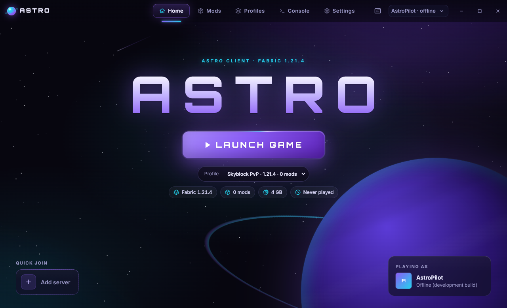
</p>

<table>
<tr>
<td width="50%">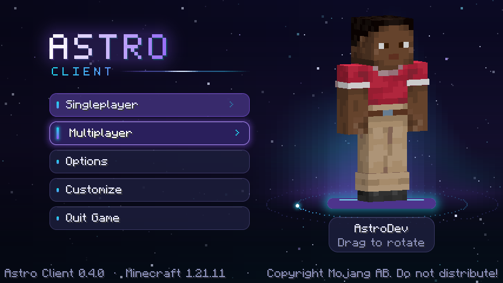<p align="center"><sub><b>Custom main menu</b></sub></p></td>
<td width="50%">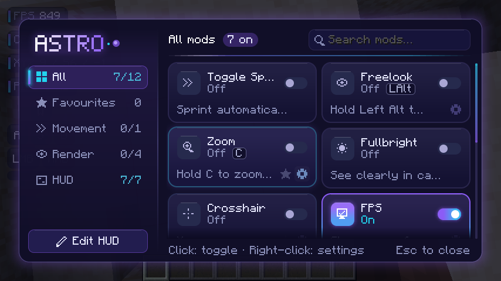<p align="center"><sub><b>Right Shift mod menu</b></sub></p></td>
</tr>
<tr>
<td>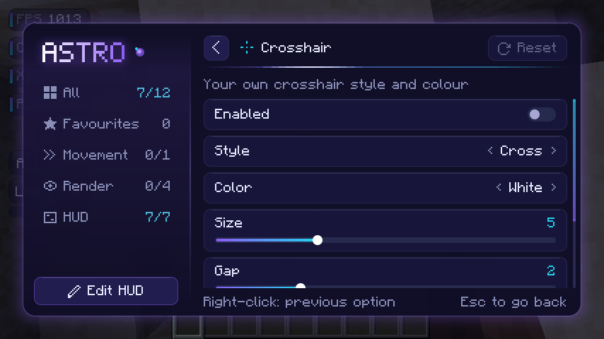<p align="center"><sub><b>Per-mod settings with reset</b></sub></p></td>
<td>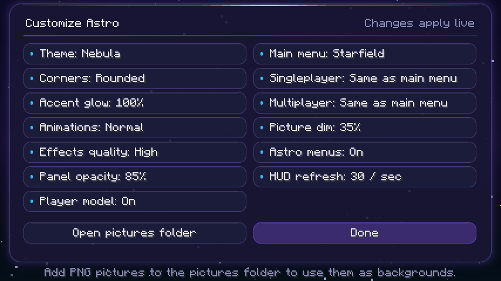<p align="center"><sub><b>Customize everything</b></sub></p></td>
</tr>
<tr>
<td>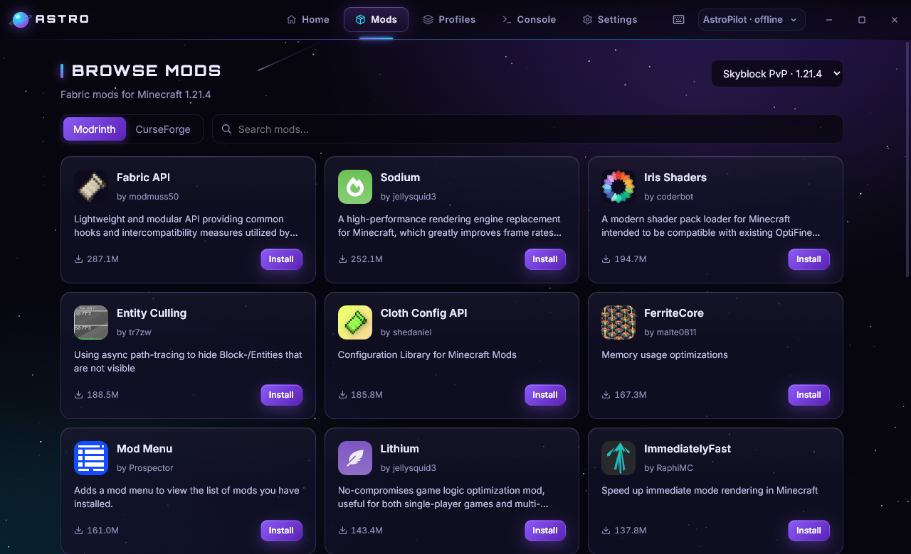<p align="center"><sub><b>Modrinth &amp; CurseForge browser</b></sub></p></td>
<td>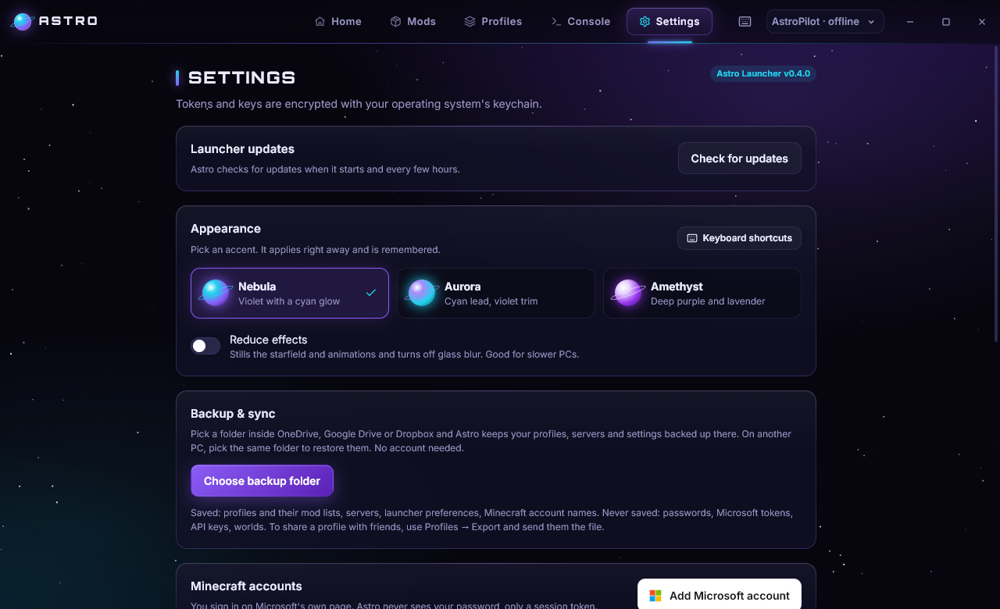<p align="center"><sub><b>Accent themes &amp; settings</b></sub></p></td>
</tr>
<tr>
<td>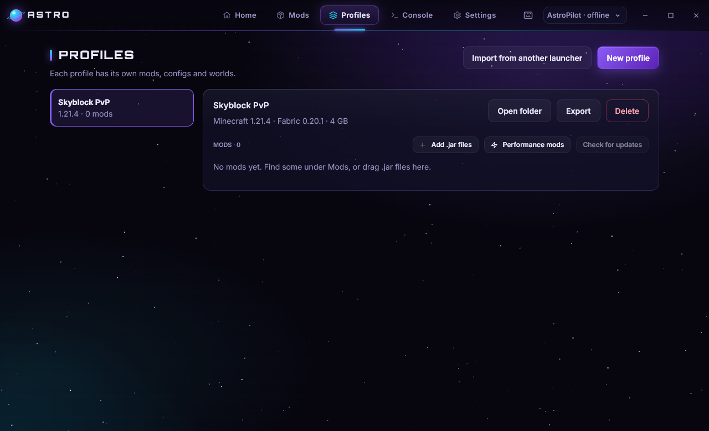<p align="center"><sub><b>Profiles with one-click performance mods</b></sub></p></td>
<td>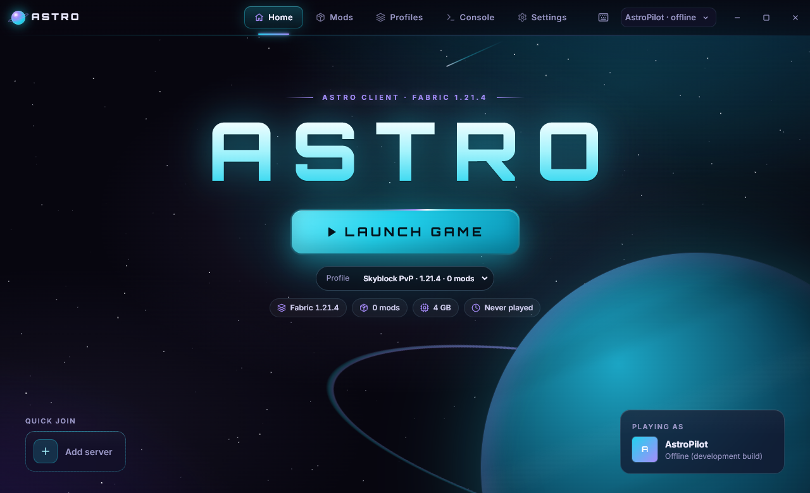<p align="center"><sub><b>Aurora accent theme</b></sub></p></td>
</tr>
<tr>
<td colspan="2">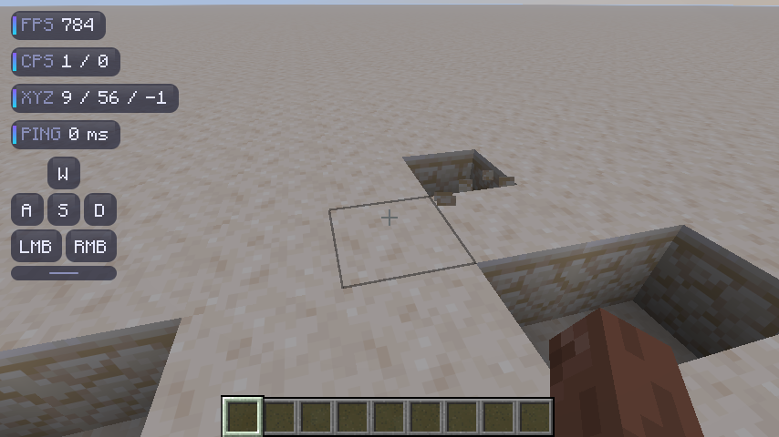<p align="center"><sub><b>HUD: FPS, CPS, coordinates, ping and keystrokes</b></sub></p></td>
</tr>
</table>

## 📥 Download

1. Grab **`Astro-Setup-<version>.exe`** from the [latest release](https://github.com/Vortexyyy/astro-releases/releases/latest).
2. Run it, sign in with Microsoft, create a profile and press **Launch**.
3. In game, press **Right Shift** to open the mod menu.

The launcher updates itself, and installs the matching Astro mod into your Fabric profiles automatically.

## 🛠️ Build from source

| Part | Stack | Folder |
| --- | --- | --- |
| 🚀 Launcher | Electron + React + TypeScript (electron-vite) | [`launcher/`](launcher) |
| 🎮 Client mod | Fabric Loader + Fabric API, Java 21, MC 1.21.1 / 1.21.10 / 1.21.11 | [`mod/`](mod) |

```bash
# client mod: builds every Minecraft version and copies the jars into the launcher
cd mod
./gradlew build copyToLauncher

# launcher: run in development mode
cd ../launcher
npm install
npm run dev
```

Architecture, every feature in detail, and release notes for maintainers live in the
**[developer guide](docs/DEVELOPMENT.md)**. Benchmarking the HUD is covered in
[`mod/BENCHMARK.md`](mod/BENCHMARK.md).

## 🔒 Privacy

- Your Microsoft sign-in happens on Microsoft's own page. Astro never sees your password.
- Tokens and API keys are encrypted with your operating system's keychain and never leave your PC.
- Backups never include passwords, tokens, API keys or worlds.
- No analytics, no telemetry, no account on any Astro server (there isn't one).

## 💜 Support the project

Astro is built in free time. The best way to help:

- ⭐ **[Star this repo](https://github.com/Vortexyyy/astro-client/stargazers)**: it genuinely helps people find it.
- 🐛 **[Open an issue](https://github.com/Vortexyyy/astro-client/issues)** for bugs or feature ideas.
- 📣 Show it to a friend who plays Minecraft.

<p align="center">
  <a href="https://github.com/Vortexyyy/astro-client/stargazers"></a>
</p>

<p align="center"><sub>Astro Client is not affiliated with Mojang Studios or Microsoft. Minecraft is a trademark of Mojang Studios.<br>© Astro Client. All rights reserved.</sub></p>
